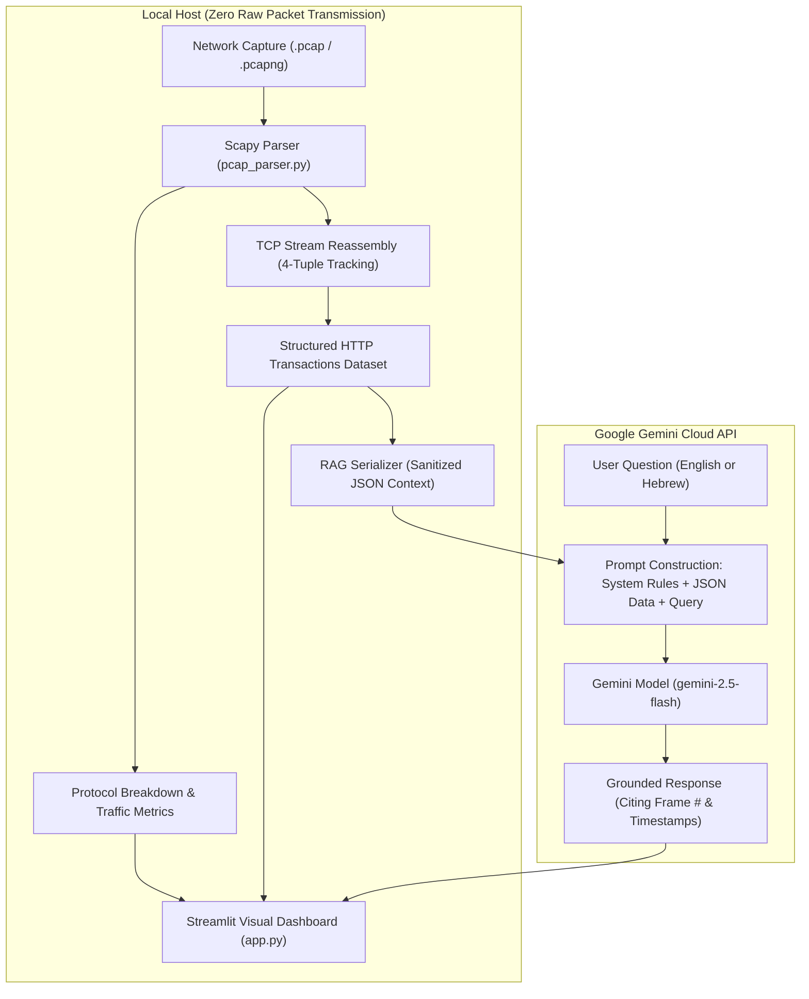
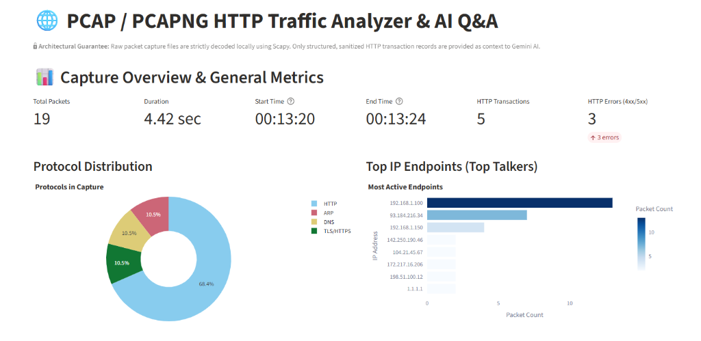
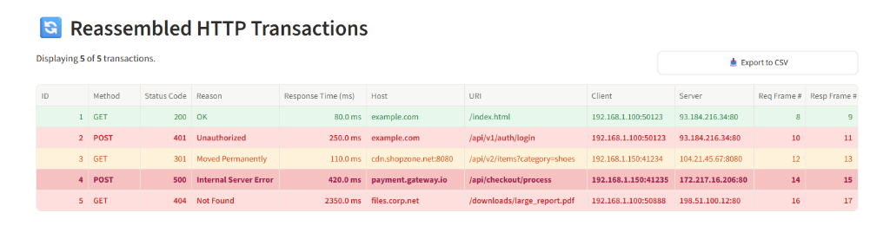
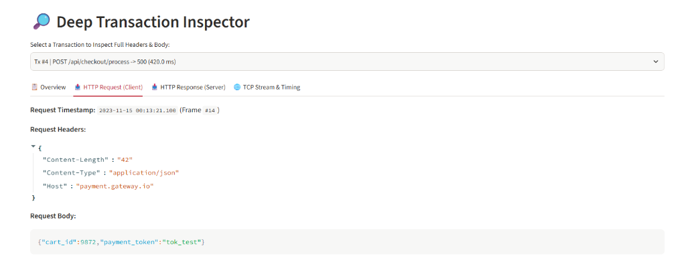
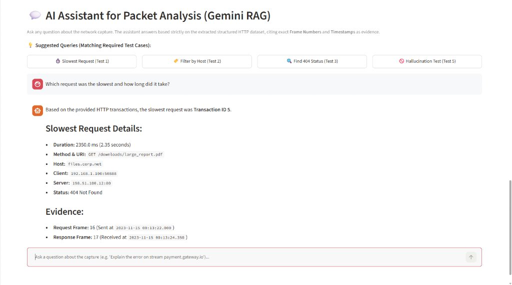

# PCAP / PCAPNG HTTP Traffic Analyzer & AI Q&A Dashboard

A network packet analysis web application built with Python, Streamlit, and Scapy. The system automatically extracts and reconstructs HTTP transactions from PCAP/PCAPNG network captures, visualizes traffic metrics and error distributions, and provides an LLM-powered natural language Q&A interface using Google Gemini.

---

## Architectural Security Guarantee

**The raw PCAP/PCAPNG capture file is never sent to the LLM.**

1. All packet decoding, protocol breakdown, and TCP session reassembly occur locally on the host using `Scapy`.
2. Extracted network events are transformed into a normalized, structured HTTP transaction dataset.
3. Only this structured dataset (sanitized JSON/Markdown) is supplied as retrieval-augmented generation (RAG) context to the Gemini API prompt along with user questions.



---

## Project Structure

```text
pcap_analyzer/
├── app.py              # Streamlit dashboard UI, interactive filters, Plotly charts, Gemini integration
├── pcap_parser.py      # Scapy packet parser, TCP stream tracking, HTTP transaction reassembly
├── generate_sample.py  # Test generator creating sample PCAP and PCAPNG files
├── sample.pcap         # Sample packet capture (19 packets, 5 HTTP transactions)
├── sample.pcapng       # Sample packet capture in PCAPNG format
├── requirements.txt    # Python package dependencies
├── .gitignore          # Git exclusion rules (.env, __pycache__, virtual environments)
├── .env.example        # Environment variable template for GEMINI_API_KEY
├── README.md           # Project documentation and setup guide
├── TESTING_GUIDE.md    # Step-by-step verification guide for all 5 assignment test cases
└── screenshots/        # Application interface walkthrough images
```

---

## Visual Walkthrough & Screenshots

### 1. Capture Overview & Protocol Distribution
Baseline packet counts, capture duration, protocol breakdown (Plotly donut chart), and top active IP endpoints (Top Talkers).



### 2. Reassembled HTTP Transactions & Visual Error Highlighting
Reconstructed HTTP sessions matching Requests to Responses with response times, TCP 4-tuples, frame numbers, and colored status code indicators (green for 2xx, yellow for 3xx, red for 4xx/5xx).



### 3. Deep Transaction Inspector
Deep inspection of any transaction displaying full request/response headers, decoded JSON payloads, and TCP connection parameters.



### 4. AI Q&A Assistant with Strict Evidence Citations
Grounded natural language Q&A powered by Google Gemini (RAG). The assistant answers user queries strictly from the structured dataset and cites exact Request/Response Frame Numbers as evidence.



---

## Core Capabilities

1. **Capture Ingestion & Baseline Metrics:**
   - Supports `.pcap` and `.pcapng` file uploads.
   - Computes total packet count, capture start/end timestamps, and duration.
   - Displays protocol breakdown (Plotly chart) and most active IP endpoints (Top Talkers).

2. **HTTP Transaction Reassembly:**
   - Maps HTTP requests to matching responses using TCP 4-tuple stream tracking and FIFO session queues.
   - Extracts: Method, URI, Host, Source/Destination IPs & Ports, Status Code, Response Time (ms), Request Frame Number, and Response Frame Number.
   - Full header and payload inspection in an expandable viewer.

3. **Error Analysis & Interactive Filtering:**
   - Visual row highlighting in the DataFrame for HTTP error status codes (4xx and 5xx).
   - Sidebar filters by Status Code, HTTP Method, Host domain, URI search, and an "Errors Only" toggle.
   - Aggregated metric counter for total HTTP errors found.

4. **Bilingual AI Q&A Engine (Google Gemini RAG):**
   - Natural language queries supported in both English and Hebrew.
   - Strict system grounding: answers are derived exclusively from the structured JSON dataset.
   - Mandatory evidence citation: the model cites exact Request/Response Frame Numbers and timestamps for every claim.
   - Zero hallucination policy: explicitly reports when queried files, protocols, or entities are absent.

---

## Getting Started

### 1. Prerequisites
- Python 3.10 or higher.
- A Google Gemini API key (free from [Google AI Studio](https://aistudio.google.com/)).

### 2. Installation
Clone or navigate to the project directory, then install dependencies:
```bash
python -m pip install -r requirements.txt
```

### 3. API Key Configuration
The file `.env.example` in this repository is a template only. Do not put real keys in it.

To enable the AI Q&A assistant:
1. Create a local `.env` file (already ignored by `.gitignore`).
2. Add your Gemini API key:
   ```env
   GEMINI_API_KEY=your_actual_gemini_api_key_here
   ```
*(Alternatively, enter your key directly into the sidebar field inside the dashboard. The local PCAP analysis, charts, and metrics work without an API key).*

### 4. Running the Application
```bash
python -m streamlit run app.py
```
Open your browser at `http://localhost:8501`.

---

## Verification & Test Cases

The application includes built-in sample captures (`sample.pcap` and `sample.pcapng`) accessible via the "Load Sample PCAP" sidebar button.

Detailed step-by-step instructions for testing all five required scenarios are documented in [TESTING_GUIDE.md](TESTING_GUIDE.md):
1. Identifying the slowest HTTP request.
2. Filtering requests by Host.
3. Querying specific status codes (e.g., 404).
4. Explaining specific TCP streams and error causes.
5. Detecting and mitigating LLM hallucinations with system prompt constraints.
